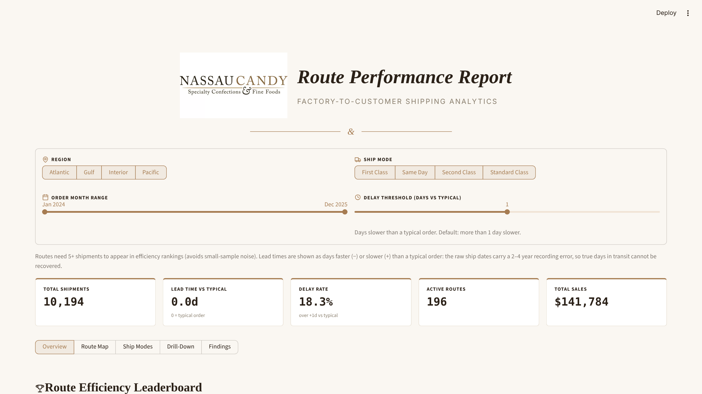

# Nassau Candy — Shipping Route Efficiency Dashboard

**Live app:** https://vipsa2207-nassau-candy-route-efficiency-dashboard-app-snxnaa.streamlit.app/

A Streamlit dashboard that compares 196 factory-to-state shipping routes on speed, consistency and delays, and shows whether ship mode or geography drives delivery time.

Project 3 of 4 · Built during my Data Analyst Internship at Unified Mentor (Jan–Jul 2026).




## The business question

Nassau Candy ships 15 products from 5 factories to customers in 59 US states and Canadian provinces. Which routes are slow or unreliable, and is the problem the route itself or the way orders are shipped?

## Key findings

- **Ship mode drives delivery time, not region.** Same Day orders arrive about **5.0 days** sooner than Standard Class. Across the four regions, average lead time differs by only **0.13 days**.
- **The same pattern shows in delays.** The delay rate varies by **30.3 percentage points** across ship modes (Standard Class 30.3%, First Class and Same Day 0%) but by only **1.3 points** across regions (17.5%–18.8%).
- **Faster shipping is the lever, not rerouting.** Moving production to a different factory or region would barely change delivery time. Changing how orders ship would.
- **Order value doesn't explain it.** Average order value and margin are almost identical across ship modes, so Standard Class isn't slow because it carries cheaper orders.

## How it works

1. **Fix the ship dates** (`src/clean_data.py`). Raw ship dates are 2 to 4 whole years after the order dates, which is impossible, and the extra years depend on when the order was placed. The script puts each order into its year-offset group and measures it against that group's typical order. Lead time becomes **days faster (−) or slower (+) than a typical order**.
2. **Build features** (`src/feature_engineering.py`). An order is **delayed** if it is more than 1 day slower than typical (18.3% of orders). Each route (factory → state) gets an **efficiency score** from 0 to 100:
   - 50% speed (lower average lead time)
   - 30% consistency (lower spread of lead times)
   - 20% reliability (lower delay rate)
3. **The dashboard** (`app.py`) has filters for region, ship mode, order month and the delay threshold, and five sections:
   - **Overview:** route leaderboard, top and bottom 10 routes
   - **Route Map:** factory-to-region shipping flows on a map
   - **Ship Modes:** speed, delays and order value by ship mode
   - **Drill-Down:** one state's factories and monthly trend
   - **Findings:** auto-written insights from the filtered data

## How well it works

- **The ship-date fix checks out.** After it, the four ship modes line up from fastest to slowest (Same Day −4.0, First Class −1.8, Second Class −0.8, Standard Class +1.0 days), and 2024 and 2025 orders run at the same speed (within 0.2 days). Under an earlier method (remainder after dividing by 30), California's 2025 orders wrongly looked about 6 days slower than its 2024 orders.
- **Small routes are excluded from rankings.** Only routes with 5 or more shipments are ranked (120 of 196), so one or two orders can't produce an extreme score.
- **State and factory findings rest on thin data.** The slowest state with 30+ shipments, Nevada (35.9% delayed), has only 39 shipments. Sugar Shack (24.2%) has only 33. Treat both as leads to investigate, not conclusions.

## Limitations

- **True days in transit are unknown.** The fix recovers how much faster or slower each order was than typical, not how many days it actually took.
- **The fix assumes each year-offset group has the same typical speed.** This is supported by ship modes being spread evenly across the groups, but it cannot be proven from this data.
- **The efficiency score's weights were set by hand,** and scores are relative to whatever is filtered, so they are not fixed ratings.
- **Sample data.** The dataset was provided for the internship and appears to be a sample, not Nassau Candy's own records.

## Run it locally

```bash
git clone https://github.com/Vipsa2207/Nassau-Candy-route-efficiency-dashboard.git
cd Nassau-Candy-route-efficiency-dashboard
pip install -r requirements.txt
streamlit run app.py
```

To rebuild the data from the raw file:

```bash
python src/clean_data.py
python src/feature_engineering.py
```

## Project files

| File | What it is |
|---|---|
| `app.py` | The Streamlit dashboard |
| `src/clean_data.py` | Fixes dates, links products to factories |
| `src/feature_engineering.py` | Delay flag and route efficiency score |
| `src/geo_lookup.py` | State and province coordinates for the map |
| `data/` | Raw, cleaned and feature data, plus the route summary |

## Research paper

I authored a research paper on this project (JETIR paper ID 584017, accepted, not published). A revised version will be added to this repository.

## How I built it

I used AI to help write the Python code. I framed the business question, worked through the ship-date problem, checked the outputs against the data, and wrote the findings. A later audit replaced the original date fix with a more accurate one.

## Author

**Vipsa Patel** — Data Analyst Intern, Unified Mentor · [LinkedIn](https://www.linkedin.com/in/vipsapatel)
